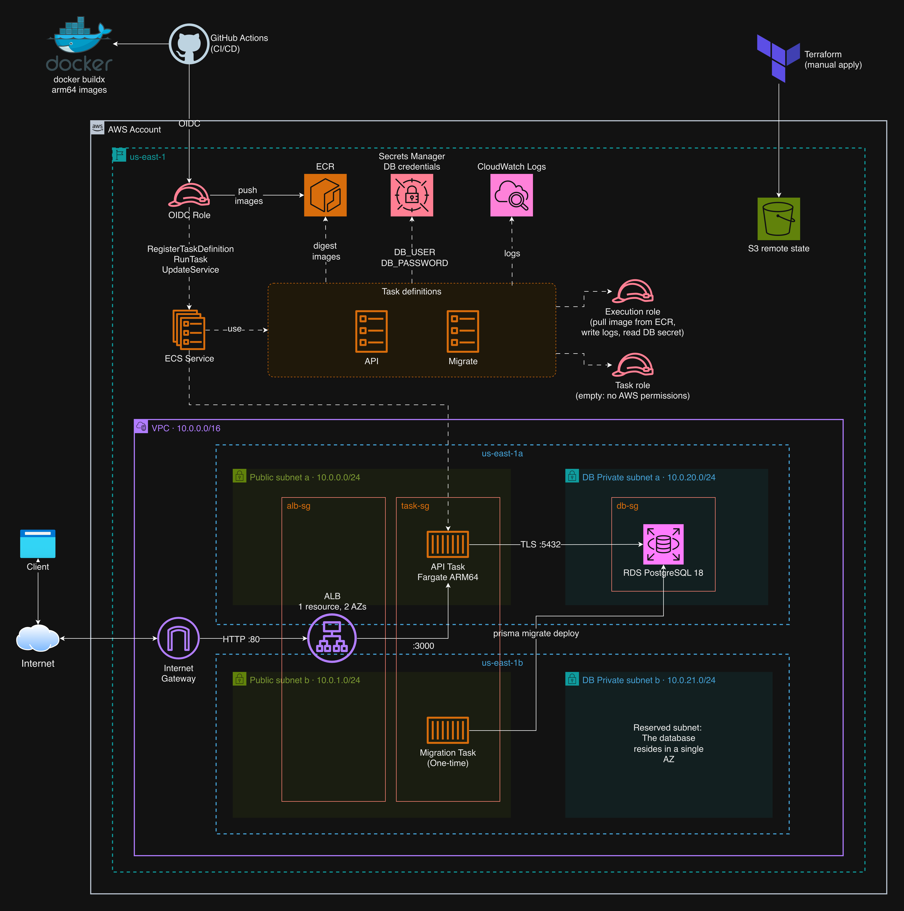

# Libris: API de monolito modular en AWS (ECS Fargate + RDS + Terraform)

API de una biblioteca (catálogo y préstamos de libros) desplegada en AWS con infraestructura como código y un pipeline de CI/CD automatizado. El repositorio muestra el camino completo del código a producción: diseño de la aplicación, contenedores, infraestructura y entrega.

La aplicación es un monolito modular. Su diseño, sus módulos y sus reglas se explican en [ts-modular-boilerplate](https://github.com/lopepardo/ts-modular-boilerplate), de donde parte este código.

## Estructura

```text
app/      API con Fastify + Prisma + PostgreSQL (ver app/README.md)
infra/    Terraform: modules/ (piezas reutilizables) y envs/prod (composición)
docs/     Diagrama de arquitectura, guía de despliegue y colección de requests
.github/  Workflows de CI y de despliegue
```

## Arquitectura



El diagrama es [docs/architecture/libris-architecture.drawio](docs/architecture/libris-architecture.drawio) (editable con draw.io): la página 1 es la infraestructura y la 2, el modelo de datos, que se ve en [data-model.png](docs/architecture/data-model.png).

## Cómo se entrega

```text
pull request   ->  CI: typecheck, lint y tests (Postgres real)
merge a main   ->  CI -> build de imágenes arm64
                      -> push a ECR
                      -> migración de BD como tarea ECS puntual
                      -> nueva revisión de la task definition -> actualización gradual
                      -> verifica que el servicio no haya hecho rollback
```

Terraform se aplica a mano y **no** forma parte del pipeline, que solo usa las APIs de ECS y ECR. Detalles y runbook en [docs/deployment.md](docs/deployment.md).

## Decisiones de diseño

| Decisión | Por qué | Trade-off | Cómo se reduce |
| --- | --- | --- | --- |
| Sin NAT gateway: tareas en subredes públicas con IP pública | Un NAT cuesta unos 33 USD/mes, dos tercios del costo total de la pila | Las tareas tienen IP pública y son alcanzables desde internet | Su security group solo acepta tráfico del balanceador por el 3000 y solo permite salida por el 443 y el 5432 |
| BD en subredes aisladas | Sin ruta a internet ni acceso público; solo las tareas llegan al puerto 5432 | Ninguno relevante | No aplica |
| Un solo entorno (`prod`) | Costo: un segundo entorno duplicaría los ~50 USD/mes | No hay dónde ensayar un cambio antes de producción | CI con Postgres real, migraciones retrocompatibles y rollback automático del despliegue |
| BD en una sola AZ, backups de 1 día | Costo: Multi-AZ duplica el precio de la instancia | Una caída de la zona deja la API sin servicio hasta restaurar desde backup | Los backups automáticos están activos; pasar a Multi-AZ es un cambio de configuración |
| ARM64 (Graviton) | Cerca de 20 % más barato en Fargate | Construir la imagen en un equipo x86 requiere emulación | Las imágenes se construyen en runners ARM nativos del CI, no en local |
| Migraciones como tarea ECS puntual | Corren dentro de la VPC, con la misma red y secretos que la app, antes de que la versión nueva reciba tráfico | La versión anterior sigue sirviendo con el esquema nuevo durante el despliegue, así que cada migración debe ser retrocompatible | Se añade primero y se elimina en un release posterior; si la migración falla, el despliegue se detiene |
| El pipeline actualiza ECS directamente; Terraform ignora la task definition | Despliegues rápidos, sin acceso al estado de Terraform ni permisos amplios | Lo desplegado y lo que Terraform conoce difieren: la imagen de `terraform.tfvars` es solo la inicial | `ignore_changes` en la task definition; la fuente de verdad de cada release es su revisión en ECS |
| Despliegue por digest de imagen | El servicio ejecuta exactamente lo que se construyó, sin depender de tags | Un digest es menos legible que un tag | El SHA del commit queda en `APP_VERSION` y en el tag de ECR |
| GitHub OIDC con rol de mínimo privilegio | Sin claves de AWS de larga vida; el rol solo confía en la identidad inmutable de este repositorio, en `main` | Si se recrea o se transfiere el repositorio, hay que actualizar el `sub` en Terraform | El valor se obtiene con un solo comando (`gh api`), documentado en la guía de despliegue |
| Solo HTTP por ahora | Todavía no hay dominio | El tráfico hacia el balanceador no va cifrado | Ninguna hasta tener dominio; HTTPS es el primer punto de la hoja de ruta |

## Costos

Estimación mensual en `us-east-1` con la pila encendida las 24 horas y poco tráfico (precios de lista, sin créditos):

| Componente                | Detalle                                                                 | USD/mes |
| ------------------------- | ----------------------------------------------------------------------- | ------- |
| Application Load Balancer | 0,0225 USD/h más un consumo mínimo de LCU                               | ~17     |
| RDS PostgreSQL            | `db.t4g.micro` (~12) + 20 GiB gp3 (~2,5)                                | ~15     |
| ECS Fargate               | 1 tarea ARM64 de 0,25 vCPU y 0,5 GiB                                    | ~7      |
| IPv4 públicas             | 0,005 USD/h por IP: 2 del balanceador (una por AZ) + 1 de la tarea      | ~11     |
| Otros                     | CloudWatch Logs, Secrets Manager (0,40 por secreto), ECR, S3 del estado | ~1-2    |
| **Total**                 |                                                                         | **~50** |

Qué mueve la cifra:

- **Las IPv4 públicas pesan casi tanto como Fargate.** Cobran desde 2024; la base de datos no las usa porque no es pública.
- **El NAT gateway que se evitó costaría unos 33 USD más** (0,045 USD/h), sin contar el tráfico procesado.
- **Cuesta lo mismo con o sin tráfico.** El balanceador y la base de datos se pagan por hora, así que la forma de ahorrar es destruir la pila cuando no se use (ver el runbook).

## Hoja de ruta

- HTTPS con dominio y certificado de ACM
- Alarmas de CloudWatch (5xx, targets no saludables, CPU y almacenamiento de la BD)
- `terraform plan` en los pull requests con un rol de solo lectura
- Un segundo entorno, si el proyecto llegara a necesitarlo
